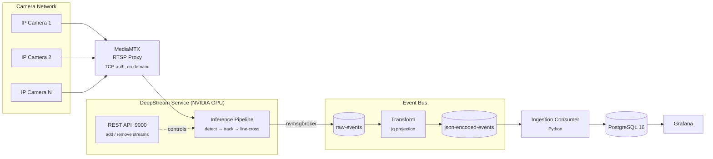
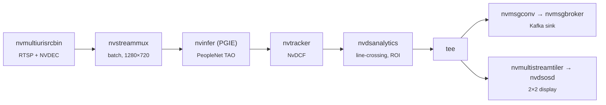
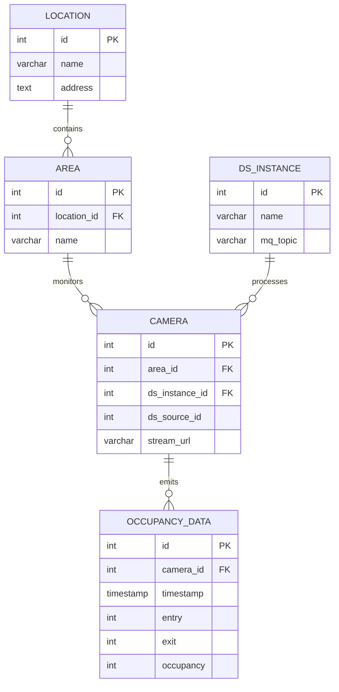

# Occupancy Analytics

**Real-time, multi-camera people counting on the GPU, streamed through Kafka into PostgreSQL and Grafana.**


The system takes live RTSP feeds from CCTV cameras and runs people detection and multi-object tracking on an NVIDIA GPU. It counts **entries, exits and live occupancy** with virtual line-crossing zones, then publishes the results as events. Those events flow through an event-driven pipeline into a relational store, where Grafana turns them into dashboards.

---

## Highlights

- **GPU-only video path.** Decode, batching, inference, tracking and analytics all run in one DeepStream / GStreamer pipeline, with zero-copy NVMM buffers between stages.
- **Stateful occupancy.** A custom metadata parser turns per-frame cumulative line-crossing counts into a running occupancy figure, guarded against drift below zero.
- **Cameras change at runtime.** `nvmultiurisrcbin` exposes a REST API for adding and removing streams. The patched version also returns the pipeline's internal `source_id`, so each stream maps reliably to a camera record.
- **Decoupled event pipeline.** Kafka sits between inference and storage. A stream transform turns the verbose DeepStream schema into a compact analytics event.
- **Normalized data model.** `Location → Area → Camera → OccupancyData`, with DeepStream instances modelled explicitly so the system can grow to several inference nodes.
- **One-command stack.** Docker Compose runs it with health-checked startup ordering and a GPU runtime for the inference service.

---

## High-Level Architecture



| Layer | Component | Responsibility |
|---|---|---|
| Ingestion | MediaMTX | Puts one authenticated, TCP-only relay in front of the cameras and decouples camera credentials from consumers |
| Inference | DeepStream 7.0 | Decodes streams, runs batched detection, tracks people and counts line crossings |
| Messaging | Kafka 3.5 | Buffers events durably and separates the inference rate from the write rate |
| Transform | Kafka → `jq` → Kafka | Cuts the full DeepStream payload down to a minimal analytics event |
| Persistence | Python consumer + PostgreSQL | Resolves `source_id → camera_id` and stores time-series occupancy rows |
| Presentation | Grafana | Shows occupancy, entry/exit trends and the location hierarchy |

---

## Low-Level Design

### 1. Inference pipeline



| Stage | Key configuration | Why |
|---|---|---|
| Source | `nvmultiurisrcbin`, REST on `:9000`, reconnect on drop | Cameras can be added or removed without restarting the pipeline |
| Muxer | Batches frames to 1280×720, 40 ms push timeout | Keeps GPU batches full while bounding latency for live sources |
| Detector | NVIDIA PeopleNet (TAO), class `person` | Pre-trained model tuned for people at CCTV angles |
| Tracker | `NvMultiObjectTracker`, NvDCF perf profile, 640×384 | Stable IDs across frames. Line-crossing needs these so it doesn't count the same person twice |
| Analytics | Per-stream `Entry` / `Exit` lines, `mode=balanced` | Checks direction with tolerance for natural walking paths |

Each camera gets its own line-crossing geometry in [`nvdsanalytics_config.txt`](deepstream/configs/nvdsanalytics_config.txt). The geometry is a direction vector plus a crossing segment, defined in a 1920×1080 reference space and scaled to the stream automatically.

### 2. Occupancy computation

`nvdsanalytics` reports **cumulative** crossings per label. The custom parser in [`deepstream_nvdsanalytics_meta.cpp`](deepstream/configs/deepstream_nvdsanalytics_meta.cpp) turns them into a running occupancy figure:

```
Δentry      = entry_cum(t) − entry_cum(t−1)
Δexit       = exit_cum(t)  − exit_cum(t−1)
occupancy  ← max(0, occupancy + Δentry − Δexit)
```

Computing from the change in each frame, instead of `entry_cum − exit_cum`, means a missed detection can be absorbed without the count sliding permanently negative.

### 3. Event contract

The DeepStream schema payload goes to `raw-events`. A streaming projection then writes a compact event to `json-encoded-events`:

```json
{
  "@timestamp": "2025-01-14T10:32:07.120Z",
  "source_id": 1,
  "Entry": 42,
  "Exit": 37,
  "occupancy": 5
}
```

The consumer only depends on this small contract. Changes to the DeepStream schema stay inside the transform step.

### 4. Ingestion consumer

[`consumer.py`](deepstream/scripts/consumer.py) works in this order:

1. On startup, it finds its `ds_instance` from the Kafka topic it subscribes to.
2. It caches the `ds_source_id → camera_id` mapping for that instance in memory, so there's no lookup per message.
3. It consumes from the `earliest` offset in a consumer group, validates `source_id` against the cache and inserts into `occupancy_data`.

### 5. Data model



The schema keeps two kinds of identity apart:
- **Physical:** location, area, camera.
- **Compute:** DeepStream instance, `ds_source_id`.

The pair `(ds_instance_id, ds_source_id)` identifies a stream uniquely across several GPU nodes. Each node publishes to its own topic, and the consumer resolves the node from that topic. Referential actions (`RESTRICT`, `SET NULL`, `CASCADE`) protect the hierarchy while still allowing compute nodes to be removed.

### 6. Stream-identity patch (`nvmultiurisrcbin`)

By default, `GET /api/v1/stream/get-stream-info` returns only `camera_id` and `camera_name`. The rest of the pipeline, including analytics metadata, is keyed by the internal `source_id`. The patched [`gstdsnvmultiurisrcbin.cpp`](deepstream/gst-plugins/gst-nvmultiurisrcbin/gstdsnvmultiurisrcbin.cpp) adds `source_id` to the response. That gives a reliable join between REST-managed cameras and the events they produce. The Docker build compiles and installs the plugin. See [INSTALLATION.md](deepstream/gst-plugins/gst-nvmultiurisrcbin/INSTALLATION.md).

---

## Repository Layout

```
.
├── docker-compose.yaml          # Full stack: postgres, kafka, deepstream, grafana
├── deepstream/
│   ├── Dockerfile               # DS 7.0 image, builds the app and the patched plugin
│   ├── configs/                 # Pipeline, analytics zones, custom meta parser
│   ├── gst-plugins/             # Patched nvmultiurisrcbin (REST stream identity)
│   └── scripts/consumer.py      # Kafka → PostgreSQL ingestion
├── kafka/                       # Kafka 3.5 + ZooKeeper image, topic bootstrap
├── postgres/schema/init.sql     # Schema, constraints, seed data
├── grafana/dashboards/          # Dashboard definitions
└── mediamtx-rtsp-proxy/         # RTSP relay for camera fan-in
```

---

## Getting Started

**Prerequisites:** a Linux host with an NVIDIA GPU (driver 535+), Docker and the NVIDIA Container Toolkit.

```bash
# 1. Point the pipeline at your streams (usually through the MediaMTX proxy)
#    deepstream/configs/dstest_occupancy_analytics.txt → [source-list] list=
#    and set Entry/Exit lines for each stream in nvdsanalytics_config.txt

# 2. Bring up the stack (startup ordering comes from health checks)
docker compose up -d --build

# 3. Open the dashboards
open http://localhost:3000
```

Startup order: **PostgreSQL → Kafka (topics created) → DeepStream + consumer → Grafana**. Each service waits until its dependencies pass their health checks.

To add a camera at runtime, without a restart:

```bash
curl -X POST http://localhost:9000/api/v1/stream/add -d '{
  "key": "sensor", "value": {
    "camera_id": "cam-04", "camera_name": "Lobby",
    "camera_url": "rtsp://<proxy>:8554/stream4", "change": "camera_add"
  }}'

curl http://localhost:9000/api/v1/stream/get-stream-info   # includes source_id
```

Per-component guides: [PostgreSQL](postgres/README.md) · [Kafka](kafka/README.md) · [DeepStream](deepstream/README.md) · [Grafana](grafana/README.md) · [RTSP Proxy](mediamtx-rtsp-proxy/README.md)

---

## Design Decisions

| Decision | Alternative | Rationale |
|---|---|---|
| DeepStream / GStreamer | OpenCV + PyTorch loop | Hardware decoding, batched TensorRT inference and zero-copy buffers scale to many streams on one GPU |
| Kafka between inference and the database | Writing to the database straight from the pipeline | A slow database can't stall the pipeline. Events can be replayed, and more consumers can be added later |
| Two topics (raw → compact) | Consumer parses the full payload | Keeps the storage contract stable and small. Raw events stay available for other uses |
| Counting by line crossing | Counting heads per frame | Works for spaces bigger than one camera's view. Entry/exit flow is itself a useful business metric |
| RTSP proxy in front of the cameras | Connecting to each camera directly | One authenticated way in, TCP for reliability, and streams pulled only when needed so cameras aren't overloaded |

---

## Roadmap

- Track occupancy per stream: key the parser's state by `source_id` for exact per-camera figures
- Load secrets from `.env` or Docker secrets instead of inline defaults
- Store `occupancy_data` as a TimescaleDB hypertable with retention policies
- Batch inserts and manual offset commits in the consumer, for exactly-once writes
- Export Prometheus metrics (FPS, end-to-end latency, consumer lag)
